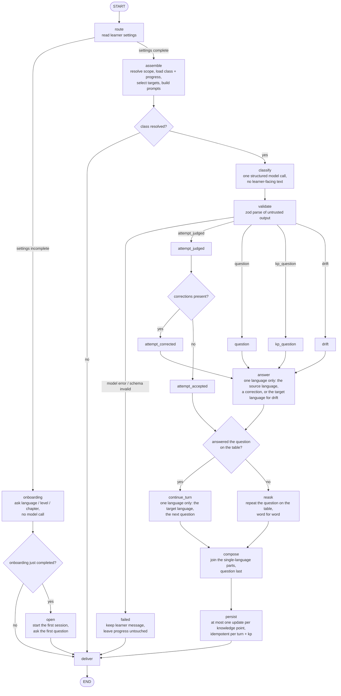

# 50 — Conversation orchestration

> Specification. Code is written from this document (`AGENT.md` §2).

This is the product's behavior layer, and it is core logic
([20-architecture.md §2](20-architecture.md)): these rules decide *what* happens;
the model decides *how* it is phrased ([40-steering.md §1](40-steering.md)).

## 1. The workflows

There are four entry points into a conversation:

| Workflow | Trigger | Shape | Code |
|---|---|---|---|
| **Onboarding** | a message while learner settings are incomplete, or a settings command | a deterministic route inside the turn graph (no model call); when it completes, `open` starts the first session and asks the first question; settings commands are linear | `engine/turn-graph.ts` (`route`/`onboarding`/`open`), `engine/onboarding.ts`, `engine/settings.ts` |
| **Session start** | the scheduler, or the end of onboarding | linear, no graph | `engine/session.ts` |
| **New conversation** | the learner's `/new` command (`/start` is an alias) | linear, no graph; it ends the question on the table and opens a fresh session whose opening asks a new question | `engine/session.ts`, `engine/index.ts` |
| **Turn** | a learner message | LangGraph state graph, four authored branches | `engine/turn-graph.ts` |

All four use the same ports and the same validation discipline. Only the turn is
a graph, because only the turn has intent branches that the model must route
(§3.1). Onboarding and settings changes are deterministic
([60-ingestion.md §3](60-ingestion.md)). Onboarding itself makes no model call;
the first session it starts after setup does.

## 2. Sessions start on a schedule

- A session is started by the **scheduler**, not only by the learner. Default:
  once daily at a set time; the learner may choose another cadence, including a
  random time during the day.
- **The learner can start a new conversation at any time.** `/new` (alias
  `/start`), typed on any channel or sent as the Discord slash command, abandons
  the question on the table (§3.3) and opens a session immediately, so the app
  asks a new question instead of repeating the one the learner left behind. It is
  the one way past the question on the table that does not require answering it.
- **A new conversation asks a new question.** The opening for a learner-started
  conversation is told the question being left behind and must not repeat or
  rephrase it. Target selection is unchanged
  ([40-steering.md §4](40-steering.md)): "new" is a new question, not a new
  steering rule.
- **The first session starts as soon as setup finishes.** When the last
  onboarding answer resolves a level to a class, the engine starts the first
  session immediately and asks the first question in the same reply, so the
  learner never has to write first to get the conversation going. Onboarding
  itself stays model-free; when the opening call fails the learner still gets the
  deterministic setup confirmation ([60-ingestion.md §3](60-ingestion.md)).
- At the scheduled moment the scheduler reads progress, picks the starting
  knowledge point via `select_targets` ([40-steering.md](40-steering.md)), and
  sends the opening message. It then **waits for the learner**.
- On every learner reply the engine re-evaluates — what the learner knows and
  what they are struggling with, from persisted counters, never from prompt
  memory — and, together with the pending knowledge points, replies so the
  conversation continues while guiding toward unlearned points.
- The schedule is set **in conversation** ([20-architecture.md §4.2](20-architecture.md)):
  no settings screen.
- Delivery is a normal channel message. The server sends it; the channel adapter
  delivers it.
- **A session never opens before onboarding is complete.** While learner settings
  are incomplete, session start returns the onboarding prompt instead of an
  opening message ([30-domain-model.md §8](30-domain-model.md)).
- **A session never opens for an unapproved learner.** An unapproved identity has
  no schedule, and the engine guard stops a revoked learner's scheduled start
  **before** the opening model call, so proactive sessions can never run up a bill
  for someone an operator has not approved
  ([74-access.md §1, §5](74-access.md)).
- TODO: cadence options and defaults; whether an unanswered session is retried;
  how the schedule is stored; cost controls for proactive turns.

### 2.1 Session-start flow

Session start is linear and makes exactly one model call. The scheduler, or the
learner's `/new` command, reads learner settings first: while they are
incomplete it returns the onboarding prompt and stops. Otherwise it resolves the
scope ([40-steering.md §2](40-steering.md)), selects the starting target, builds
the opening message through the model port, and appends it. The turn graph calls
the same path from its `open` node the moment onboarding completes, so the first
question is asked without waiting for the scheduler.

A registered `startSession` returns `handledAs ∈ {needs_onboarding, no_class,
no_targets, opened, provider_failed}` and appends the opening message only when
it opened. The learner's command goes through `startConversation`, the same flow
with `reason: new_conversation`: it reads the question on the table and passes it
to the opening prompt as the question not to repeat (§2). The scheduled and
post-onboarding openings keep the existing framing — the learner did not ask for
them, so they must not read like a study reminder.

Typed chat commands are recognised wherever a settings command is
([30-domain-model.md §8](30-domain-model.md)): `/new` and `/start` are routed to
`startConversation` before the settings dispatcher sees them, so the entry point
works on every channel, not only where slash commands can be registered.

## 3. Every message runs its own workflow

A message is **not** handled by one monolithic system prompt. It enters a
per-message workflow with boundary decisions: assemble context and targets, ask
the model to decide, validate the untrusted output end to end, then route on the
branch the model chose.

### 3.1 Why a graph

- **The model picks the branch.** Classifying learner intent — a genuine attempt
  vs. a linguistic question vs. drift — has no deterministic derivation
  ([40-steering.md §1](40-steering.md)); that is why a graph engine is justified
  here ([10-overview.md §3.1](10-overview.md)).
- **The branch set is authored**, versioned, and reviewed like a prompt. The
  model selects among branches; it does not invent the workflow at runtime.
- **The graph is code.** Version it, review it in diffs, and treat a change to it
  as a behavior change.

### 3.2 The graph

Nodes are the functions in `engine/turn-graph.ts`; edges are the routing rules
compiled into the `StateGraph`. `START`/`END` are the graph's entry and exit.
`route` is a deterministic decision made before any model call; `onboarding`
makes no model call, and once it completes `open` starts the first session.
`classify` decides the branch and writes no prose; `answer` writes an answer, a
correction, or a drift response in one language; `continue_turn` writes the next
target-language turn and only runs when the learner answered; `reask` repeats the
question on the table word for word.



Text fallback, for readers or renderers without Mermaid:

```
START
  └─ route ──settings incomplete──> onboarding
        │                                 │ onboarding complete ──> open ──> deliver ─> END
        │                                 └─ still incomplete ────> deliver ─> END
        │ settings complete
        ▼
      assemble ──── class missing? ──yes──> deliver
        │ no
        ▼
      classify ────> validate ──model error | invalid──> failed ──> deliver
        │
        ├─ attempt_judged ─> attempt_judged ─ corrections? ─┬─yes─> attempt_corrected ─┐
        │                                                  └─no──> attempt_accepted ──┤
        └─ question / kp_question / drift ─> answer ───────────────────────────────────┤
                                                                                       ▼
                                                                  answered the question on the table?
                                                                    │ yes                     │ no
                                                                    ▼                         ▼
                                                              continue_turn               reask (repeat it)
                                                                    │                         │
                                                                    └────────> compose <───────┘
                                                                                   │
                                                                                   ▼
                                                                                persist ─> deliver ─> END
```

### 3.3 The four branches

| Branch the model returns | Meaning | `handledAs` | Progress effect |
|---|---|---|---|
| `attempt_judged` | The learner tried to use the material | `corrected` if a correction is present, else `accepted` | counters from the turn's signals (§4) |
| `question` | A general linguistic question (unknown word or construction) | `answered_question`, or `reasked_previous_question` when the question on the table was not answered | none |
| `kp_question` | A question about a current knowledge point | `answered_knowledge_point_question`, or `reasked_previous_question` when the question on the table was not answered | none, but the interaction is recorded against the point |
| `drift` | Off-topic | `reanchored_after_drift`, or `reasked_previous_question` when the question on the table was not answered | none |

**Each message is written in one language.** A question is answered, and a wrong
attempt is corrected, by the `answer` call in the class's source language —
English for the shipped German and Chinese classes — so an explanation is never
harder to read than the material it explains; the same call acknowledges drift in the
target language. The next conversational turn is written by a separate
`continue_turn` call in the target language. The app joins the parts with the
question last (§3.5), so no single model call ever switches language mid-message.

**The question on the table is re-asked, never replaced.** Every classify call
returns `answered_previous_question`. It is `true` only when the learner's message
is a clear attempt to answer the question the app last asked — a linguistically
wrong attempt still counts. It is `false` when the learner asked something
instead, said they did not understand, asked for a repeat or an explanation, or
changed the subject. On `false` the `answer` call handles what they said and the
app then repeats the same question word for word; `continue_turn` does not run.
The next question waits until the learner answers. When the app has not asked a
question yet, the field is `true`. The one exception is the learner starting a new
conversation (§2): `/new` never enters the turn graph, so it replaces the question
on the table without an answer.

When no branch is reachable because the model failed or its output did not
validate, `handledAs` is `provider_failed` or `invalid_output` and the reply is
the generic failure message.

### 3.4 Rules that hold on every path

- **A knowledge-point question is answered before re-anchoring.** The engine
  records the interaction against the knowledge point and answers, then re-asks
  the question on the table (§3.3).
- **Drift is handled by a soft re-anchor, never a clamp**
  ([20-architecture.md §4.3](20-architecture.md)). Handle the off-topic message,
  then steer back by repeating the question on the table; never refuse or lecture.
- **A clear attempt counts as an answer, even a wrong one.** The learner is only
  held on the same question when they did not attempt it at all (§3.3).
- **One call, one language.** The `answer` call writes only the source language
  (the target language on drift) and `continue_turn` writes only the target
  language; the app composes the learner's message from those parts, with the
  question last (§3.5).
- **Every path still produces at most one progress update per turn**, by ID,
  idempotent ([30-domain-model.md §2](30-domain-model.md)).
- **A provider failure keeps the learner's message.** The `failed` node appends
  the incoming message and leaves progress untouched, so nothing is lost.
- **The learner always receives one reply.** `deliver` substitutes the generic
  failure text if a branch produced nothing.
- **Onboarding runs before any teaching turn.** While learner settings are
  incomplete, the turn routes to `onboarding`, which makes no model call and
  writes no progress; the learner is asked the next question
  ([30-domain-model.md §8](30-domain-model.md)).
- **The first question is asked for the learner.** When the last onboarding
  answer completes setup, the graph routes to `open`, which starts the first
  session and asks the first question in the same reply. Onboarding itself stays
  model-free; if the opening call fails, the deterministic setup confirmation is
  delivered instead (§2).
- TODO: the full branch set; how drift is detected and bounded.

### 3.5 Three calls, one language each

A turn is classified first, then written by up to two single-language calls:

1. **classify** — always. Returns the branch, the corrections, the progress
   signals, and `answered_previous_question`. It writes nothing the learner sees.
2. **answer** — when the branch is `question`, `kp_question`, or `drift`, or when
   an `attempt_judged` turn carries corrections. It writes one message in one
   language: the source language for a question or a correction, the target
   language for drift.
3. **continue_turn** — only when the learner answered. It writes the next turn in
   the target language. A correction has already been explained by the `answer`
   call in the source language, so it is not repeated here.

The app composes the learner-facing message from the parts, with the question
last: the `answer` part (when present) followed by either the `continue_turn`
part (when the learner answered) or the repeated question. The question is
therefore always the last paragraph of the app's reply, which is exactly what
`pendingQuestionOf` reads to build the next turn's question on the table
(`core/domain/turn.ts`). A prose call that fails or returns invalid output
contributes nothing; if every part is empty the learner gets the generic failure
message, while the classify call's progress signals are still applied.

## 4. The turn contract

The model returns structured output, never prose alone. The shape is defined by
`core/domain/turn.ts` and is validated before any write.

```ts
TurnDecision = {
  branch: "attempt_judged" | "question" | "kp_question" | "drift",
  corrections: Array<{ span: string; fix: string; reason: string }>,   // small + inline
  signals: Array<{
    knowledge_point_id: string,   // must be an ID from the provided target list
    outcome: "used" | "used_with_help" | "wrong" | "seen",
    evidence: string,
  }>,
  answered_previous_question: boolean,   // a clear attempt at the question on the table (§3.3)
}

AnswerResult = { reply: string }                          // source language (target for drift)
ContinuationResult = { feedback: string, question: string }   // target language
```

Invariants enforced in `core/`:

- at most one update per (turn, knowledge point);
- IDs not in the turn's provided target list are **logged as unattributed and
  dropped**, never fuzzy-matched ([30-domain-model.md §2](30-domain-model.md));
- the schema is validated before any write.

The exact rule and its worked example are recorded in
[80-decisions.md](80-decisions.md); `MVP.md` §5.1 holds the proposal text.

## 5. Model calls per turn

Up to three: one `classify` call, plus `answer` when the message is not an answer
or carries a correction, plus `continue_turn` when the learner answered. A correct
answer is two calls (classify + continue); a wrong answer is three (classify +
answer + continue); an unanswered question is two (classify + answer). Each call
may use the adapter's bounded repair/retry. The split exists so that no call has
to change language mid-message (§3.5); adding or removing a call is a design
change (§3.1).

## 6. Diagram maintenance

- The Mermaid source for the turn graph is duplicated in
  [`turn-graph.mmd`](turn-graph.mmd) so it can be rendered or diffed on its own.
- **When the graph changes, update the diagram in the same commit.** A stale
  diagram is worse than none: it documents a workflow that no longer runs.
- Rendering is not part of the build gate yet (see
  [80-decisions.md](80-decisions.md)). Mermaid renders on GitHub; no local
  renderer is configured, so do not claim a rendered diagram was verified.
